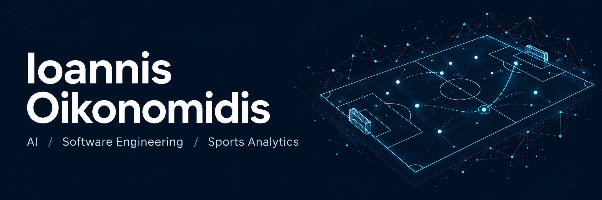

  
  &nbsp;
  
  &nbsp;
  

### Hi, I'm Ioannis 👋

I'm a software developer and MSc student in **Data Science and Information Technologies at the University of Athens**, specializing in Big Data and Artificial Intelligence. I build deep learning experiments, data analysis tools, and full-stack applications.

- 🧠 Interested in **computer vision, transformers, and learning from video**.
- 🎓 My BSc thesis explored **football action anticipation** using transformer-based deep learning.
- ⚽ A professional football background in **Greece and Spain** shapes my interest in sports analytics and AI for football.

### Skills & tools

**Languages & AI**

**Web development & engineering**

More of my toolkit

**Data analysis:** SQL, pandas, matplotlib, seaborn, Excel, Power BI, and Tableau.  
**Areas I explore:** computer vision, deep learning, transformers, AI agents, and retrieval-augmented generation.

### Selected work

| Project | What I explored | Stack |
| :--- | :--- | :--- |
| ⚽ [Football Action Anticipation](https://ioannisoikonomidis.netlify.app/#projects) | Anticipating future football actions from video; my BSc thesis. | Python · PyTorch · Transformers |
| 🧬 [Protein Remote Homolog Search](https://github.com/Oiko8/Protein-Remote-Homologs) | ESM-2 protein embeddings and approximate nearest-neighbor search, evaluated against BLAST. | Python · ESM-2 · ANN |
| 🎟️ [Planent](https://github.com/Oiko8/Planent_Web_App) | A full-stack application for event management and online ticket booking. | React · TypeScript · Spring Boot · MySQL |

Explore the research behind the projects

**Football action anticipation**  
Explored future-feature forecasting with DINOv2, retrieval-based memory, and possession-change auxiliary prediction. [View the project and demo →](https://ioannisoikonomidis.netlify.app/#projects)

**Neural LSH**  
Built a learning-based approximate nearest-neighbor search pipeline using graph partitioning and an MLP, evaluating recall, approximation quality, and query throughput. [Explore the repository →](https://github.com/Oiko8/Neural_LSH)

---

Interested in **AI, software development, or sports analytics**? [Let's connect.](https://www.linkedin.com/in/ioannis-oikonomidis-b03460320)
